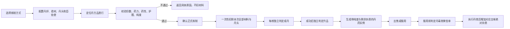

# 炼丹系统 · 程序开发策划案 v2.7
**性质**：炼丹后台规则、配置字段、跨表引用、结算公式、取整、存档、日志与前后台数据合同的正式交付文件。前台布局、控件、操作流程与玩家文案以《炼丹系统交互案 v1.4》为准；程序开发必须同时读取两份文件。

**取代**：程序开发策划案 v2.6及更早程序策划案。本文与《炼丹系统交互案 v1.4》共同构成程序施工交付；配置表字段与程序使用说明继续作为策划维护配置结构的正式文档，本文已完整镜像其运行合同。

**交互基准**：《炼丹系统交互案 v1.4》；《炼丹交互原型 v1.0》用于展示主面板布局与核心操作，示例材料、丹方和数值不进入正式配置。

**数值状态**：灵植的药力、杂质、药性等既有参数保持不变；除渣力档位及其关联的丹方纯度、最低杂质门槛按本文规则重新标定，讨论中的百分比例子不作为定案数值。其余配置维持原有数值。尚未确定的药效保持 `pill_effects` 未配置；具体类型及引用由确认后的药效规则填写。**程序一律读取导表配置，不得把任何数值写成代码常量。**

## 1. 系统边界与术语

### 1.1 职责划分
权威结算层负责：配置校验、丹方定位、数值计算、库存与神识复核、扣料、随机判定、产物与配方存档、服用与丹毒事务。

前台负责：提交输入、请求预览、展示权威结果。

预览与正式炼制使用**同一套无状态计算**。正式操作时重新读取当前配置、角色、技能、库存和丹炉；前台传来的药力、纯度、概率、售价等派生值**不是权威输入**，一律重算。

实际类名、文件组织和序列化形式由程序按项目架构确定。

### 1.2 一炉的构成
每炉固定投入：**一份君材、一个丹头**，以及**至少一份臣材、至少一份使材、零至多份佐材**。

| 材位 | 数量 | 职责 |
|---|---|---|
| 君材 | 每炉固定 1 份 | 决定本炉境界、基础品质和药力门槛；其药性构成开炉初值 |

| 材位 | 数量 | 职责 |
|---|---|---|
| 丹头 | 每炉固定 1 个 | 给出臣佐使最大承药份数；可作为特殊丹方凭证 |

| 材位 | 数量 | 职责 |
|---|---|---|
| 臣材 | ≥1 份 | 决定丹药作用（五行） |

| 材位 | 数量 | 职责 |
|---|---|---|
| 使材 | ≥1 份 | 决定丹药作用部位（五味），并决定服药入哪个丹毒池 |

| 材位 | 数量 | 职责 |
|---|---|---|
| 佐材 | 0..N 份 | 补药力、调药性 |

**丹头不参与药力、药性、绝对杂质求和**，但**随炉消耗**（见 §7.3）。

### 1.3 枚举与序列
**项目统一大境界**：采用 `MajorRealm`，炼气至大乘依次为 1—8，中文别名与合法数字兼容。0 为保留值，不代表炼气；境界差使用同一枚举计算。炼气境不开放炼丹，丹方境界为筑基至大乘，丹毒池仍须覆盖角色炼气阶段。

**品质枚举 `ItemQuality`**（自低到高，序号 1..6，对应除渣力表的 `filter1..filter6`）：

```text
1 凡品   2 灵品   3 玄品   4 仙品   5 神品   6 道品
```

**五行**：金、木、水、火、土。
**五味固定映射**：

```text
酸 → 血肉    苦 → 心神    甘 → 丹田    辛 → 气脉    咸 → 骨底
```

**自由炼制主坐标**：`[realm, jun_quality, element, taste, nval]`；同一主坐标允许普通丹方与不同指定丹头丹方并存，最终按实际丹头消歧（§5.3）。

**万分比**：`0..10000` 的整数。**全系统不使用小数**；配置表内以小数书写的参数在加载时一次性换算为万分比整数（见 §3.9.2）。

**丹方规模**：7 可炼境界 × 5 五行 × 5 五味 × 5 档最终药性 = 875 个基础丹方坐标；每张基础丹方开放其中三个品质 → 2625 个丹方品质行。程序不硬编码这些数量，只按配置加载。

### 1.4 手动炼丹与丹方炼丹
炼丹分为两种玩家操作模式，二者共用材料合法性、成丹条件与结算规则。

| 炼丹模式 | 玩家操作 | 丹方与配方的使用方式 |
|---|---|---|
| 手动炼丹 | 玩家自行配置君材、丹头及臣佐使材料，调整真实入炉顺序并进行炼丹 | 配置满足成丹条件后，由玩家主动执行“保存配方”，将有效配法保存为可供丹方炼丹使用的玩家配方 |

| 炼丹模式 | 玩家操作 | 丹方与配方的使用方式 |
|---|---|---|
| 丹方炼丹 | 玩家从已经获得的丹方列表中选择丹方，载入配方后进行炼丹 | 有玩家保存配方时优先使用玩家配方，否则使用系统默认投料；可按既有批次规则批量炼制 |

### 1.5 丹方炼丹列表的三种来源
“丹方炼丹”列表汇总玩家通过三种途径获得的丹方，并按当前选择的境界展示。同一基础丹方按 `recipe_id` 合并为一个条目。

| 丹方来源 | 获得条件 | 进入丹方炼丹列表的时机 |
|---|---|---|
| 默认丹方 | 玩家初始获得策划配置的若干基础丹方 | 默认丹方授予成功后即可列出，具体丹方与数量由配置决定 |

| 丹方来源 | 获得条件 | 进入丹方炼丹列表的时机 |
|---|---|---|
| 道具获得 | 玩家使用对应的丹方道具 | 丹方道具使用成功、获得对应丹方后列出 |

| 丹方来源 | 获得条件 | 进入丹方炼丹列表的时机 |
|---|---|---|
| 手动保存 | 玩家在手动炼丹中配置出有效配方，并主动执行“保存配方” | 配方保存成功后，列出对应丹方并使用玩家保存的配法 |

手动配置通过预览后不会自动保存配方。只有玩家主动保存成功，才通过“手动保存”来源获得对应丹方。正式炼制成功产生的丹方发现记录，不代替手动保存。

## 2. 状态机与总流程

### 2.1 闭环


### 2.2 炼制状态
| 状态 | 进入条件 | 可用操作 | 扣料 |
|---|---|---|---|
| 未配置 | 打开界面、切换境界或清空草稿 | 选炉、选丹方、选材 | 否 |

| 状态 | 进入条件 | 可用操作 | 扣料 |
|---|---|---|---|
| 配置中 | 草稿发生变动 | 编辑、预览 | 否 |

| 状态 | 进入条件 | 可用操作 | 扣料 |
|---|---|---|---|
| 配置不通过 | 预览存在阻断项 | 查看原因、继续编辑 | 否 |

| 状态 | 进入条件 | 可用操作 | 扣料 |
|---|---|---|---|
| 可正式炼制 | 全部硬条件通过且 `maxBatch ≥ 1` | 设数量、确认 | 否 |

| 状态 | 进入条件 | 可用操作 | 扣料 |
|---|---|---|---|
| 正式结算中 | 服务器接受新 `requestId` | 禁用重复提交 | 事务中 |

| 状态 | 进入条件 | 可用操作 | 扣料 |
|---|---|---|---|
| 结果 | 事务提交 | 看结果、返回主面板 | 已结算 |

### 2.3 总流程
创建或载入草稿 → 预览与硬条件校验 → 确认请求 → 权威重校验与一次性扣料 → 逐枚成丹、逐枚升品 → 生成丹药实例 → 服用与丹毒结算。

**任一配置阶段失败不扣料；单枚成丹失败不退该枚材料。**

## 3. 配置数据源

### 3.1 工作簿、运行页签与查询键
| 工作簿 | 运行页签（技术表ID） | 查询键 | 本表唯一保存的内容 |
|---|---|---|---|
| `L灵植表.xlsx` | `灵植表` | `id` | 君、臣、佐、使、丹头的ID、名称、境界、材位、品质及各材位固有属性 |

| 工作簿 | 运行页签（技术表ID） | 查询键 | 本表唯一保存的内容 |
|---|---|---|---|
| `D丹方丹效表.xlsx` | `丹方表` | `id`、`recipe_id`、自由坐标 | 每个基础丹方每个开放品质的识别信息、君材品质、成丹条件、默认投料、成丹率、升品率、丹效、持续时间、成品物品关联 |

| 工作簿 | 运行页签（技术表ID） | 查询键 | 本表唯一保存的内容 |
|---|---|---|---|
| `D丹方丹效表.xlsx` | `除渣力` | `[source_type, source_id]` | 炼丹术、灵植术、丹炉按来源ID与基准境界配置的六品质同境基础除渣率，以及丹炉五行额外除渣率 |

| 工作簿 | 运行页签（技术表ID） | 查询键 | 本表唯一保存的内容 |
|---|---|---|---|
| `D丹方丹效表.xlsx` | `丹毒池` | `base_realm` | 各角色境界、各五味的池容量与每日消退率 |

| 工作簿 | 运行页签（技术表ID） | 查询键 | 本表唯一保存的内容 |
|---|---|---|---|
| `D丹方丹效表.xlsx` | `成丹率描述` | `id`、闭区间 | 成丹率区间对应的前台文字 |

| 工作簿 | 运行页签（技术表ID） | 查询键 | 本表唯一保存的内容 |
|---|---|---|---|
| `D丹方丹效表.xlsx` | `杂质售价` | `id`、闭区间 | 实际杂质占比对应的成色档与售价系数 |

| 工作簿 | 运行页签（技术表ID） | 查询键 | 本表唯一保存的内容 |
|---|---|---|---|
| `D丹炉表.xlsx` | `furnace_config` | `id` | 丹炉ID、名称、最高可炼境界、品质、承寒下限、承热上限、神识门槛、价格、启用状态 |

| 工作簿 | 运行页签（技术表ID） | 查询键 | 本表唯一保存的内容 |
|---|---|---|---|
| `X系统参数.xlsx` | `ConfigSystemVar` | `ParamID` | 低境界炼丹倍率、炼丹术熟练参数、灵植术熟练参数、丹毒效果减半线 |

| 工作簿 | 运行页签（技术表ID） | 查询键 | 本表唯一保存的内容 |
|---|---|---|---|
| `S属性配置表.xlsx` | `attr_config` | `name` | 五味绝对杂质与丹毒、神识及丹效可操作属性的项目属性接口 |

**每项数据只有一个权威归属**：

- 丹炉的过滤率**不在丹炉表**，按丹炉 `id` 保存在 `除渣力` 表的 `source_type=丹炉` 行；
- 最低纯度、成丹率封顶纯度、最低杂质、神识要求、基础成丹率、成丹率上限、升品率、丹效**保存在丹方品质行**；物品基础售价由对应物品 `sell_price` 提供；
- 特殊丹头关系由丹方表的 `head_id` 引用；
- 丹毒禁服线固定为 `10000`，**不设系统参数**；减半线读系统参数；容量与消退率读 `丹毒池`。

各工作簿内的「说明」「计算」「编号」「数值施工」等页签**不进入运行时**，程序不读取。

### 3.2 表头合同与通用加载规则
Luban 导表头：

| 行 | 标记 | 含义 |
|---|---|---|
| 第1行 | `##var` | 稳定技术字段名 |

| 行 | 标记 | 含义 |
|---|---|---|
| 第2行 | `##type` | 导出类型 |

| 行 | 标记 | 含义 |
|---|---|---|
| 第3行 | `##group` | 导出分组 |

| 行 | 标记 | 含义 |
|---|---|---|
| 第4行 | `##` | 中文显示名 |

| 行 | 标记 | 含义 |
|---|---|---|
| 第5行起 | — | 数据行 |

- 程序读取导表生成的数据对象，**不按中文表头、不按 Excel 列序号、不按策划整理列取值**。
- `X系统参数.xlsx` 与 `S属性配置表.xlsx` 沿用项目现有导表合同，不用新表的 `c` 分组规则反推其导出范围。
- `seq` 只用于策划排序，运行时忽略。
- 实体引用一律使用**整数ID**；名称只用于显示与检查。
- **可选整数引用必须由配置显式填写 `0`**；空单元格不等于 `0`，程序不做静默归一，遇空即报 `CONFIG_INVALID`。
- 每个丹方品质行的效果与成丹条件读取自身配置，不从相邻行继承。系统默认投料读取同组最低启用品质行；其他品质行默认投料未配置时不自动补值，也不因此禁止合法自由炼制。
- 加载完成后的配置对象**只读**：不排序、不修正、不回写。

### 3.3 灵植表 `灵植表`
| 技术字段 | 类型 | 中文表头 | 程序含义与范围 |
|---|---|---|---|
| `seq` | `int` | 序号 | 仅策划排序 |

| 技术字段 | 类型 | 中文表头 | 程序含义与范围 |
|---|---|---|---|
| `id` | `int` | 灵植ID | 材料／丹头属性配置 ID；背包、库存和扣料使用对应物品 ID，不能混用 |

| 技术字段 | 类型 | 中文表头 | 程序含义与范围 |
|---|---|---|---|
| `name` | `string` | 名称 | 检查用名称；正式显示名以物品系统为准 |

| 技术字段 | 类型 | 中文表头 | 程序含义与范围 |
|---|---|---|---|
| `realm` | `MajorRealm` | 境界 | 材料所属大境界 |

| 技术字段 | 类型 | 中文表头 | 程序含义与范围 |
|---|---|---|---|
| `role` | `string` | 分类 | 仅 `君`、`臣`、`佐`、`使`、`丹头` |

| 技术字段 | 类型 | 中文表头 | 程序含义与范围 |
|---|---|---|---|
| `quality` | `string` | 品质 | 六品质枚举之一 |

| 技术字段 | 类型 | 中文表头 | 程序含义与范围 |
|---|---|---|---|
| `element` | `string` | 五行[仅臣] | 仅臣材必填，金木水火土 |

| 技术字段 | 类型 | 中文表头 | 程序含义与范围 |
|---|---|---|---|
| `taste` | `string` | 五味[仅使] | 仅使材必填，酸苦甘辛咸 |

| 技术字段 | 类型 | 中文表头 | 程序含义与范围 |
|---|---|---|---|
| `max_material_count` | `int` | 最大承药份数[仅丹头] | 仅丹头必填，正整数；臣佐使合计份数上限 |

| 技术字段 | 类型 | 中文表头 | 程序含义与范围 |
|---|---|---|---|
| `nval` | `int` | 性值 | 君材开炉药性或单份药性增量，范围 `−4..+4` |

| 技术字段 | 类型 | 中文表头 | 程序含义与范围 |
|---|---|---|---|
| `power` | `int` | 单份药力 | 君臣佐使单份药力，非负整数 |

| 技术字段 | 类型 | 中文表头 | 程序含义与范围 |
|---|---|---|---|
| `dross` | `int` | 杂质 | 君臣佐使单份绝对杂质，非负整数 |

| 技术字段 | 类型 | 中文表头 | 程序含义与范围 |
|---|---|---|---|
| `target_power` | `int` | 目标药力[仅君] | 仅君材必填，正整数；本炉药力门槛 `U` |

| 技术字段 | 类型 | 中文表头 | 程序含义与范围 |
|---|---|---|---|
| 对应物品 `sell_price` | `long` | 基础售价 | 按实际灵植物品 ID 从物品表读取；不另读灵植表 `price` 作为售价来源 |

`灵植分类`、`药势`、`ID编号用` 等为策划整理列，不导出、不读取。

**各材位必填运行字段**：

| 材位 | 必填字段 |
|---|---|
| 君 | `id, realm, quality, nval, power, dross, target_power` |

| 材位 | 必填字段 |
|---|---|
| 臣 | `id, realm, quality, element, nval, power, dross` |

| 材位 | 必填字段 |
|---|---|
| 佐 | `id, realm, quality, nval, power, dross` |

| 材位 | 必填字段 |
|---|---|
| 使 | `id, realm, quality, taste, nval, power, dross` |

| 材位 | 必填字段 |
|---|---|
| 丹头 | `id, realm, quality, max_material_count` |

### 3.4 丹方表 `丹方表`
一行 = 一个基础丹方坐标的一个基础成丹品质。同一基础丹方的开放品质行共用 `recipe_id`，每行完整保存本品质的全部内容，**行间不继承空值**。

#### 3.4.1 识别与品质
| 技术字段 | 类型 | 中文表头 | 程序含义与范围 |
|---|---|---|---|
| `id` | `int` | ID | 品质行唯一主键 |

| 技术字段 | 类型 | 中文表头 | 程序含义与范围 |
|---|---|---|---|
| `recipe_id` | `int` | 丹方ID | 同一基础丹方的组键 |

| 技术字段 | 类型 | 中文表头 | 程序含义与范围 |
|---|---|---|---|
| `pill_name` | `string` | 正式丹名 | 本品质成品显示名 |

| 技术字段 | 类型 | 中文表头 | 程序含义与范围 |
|---|---|---|---|
| `rule_name` | `string` | 规则小名 | 策划识别名 |

| 技术字段 | 类型 | 中文表头 | 程序含义与范围 |
|---|---|---|---|
| `effect_desc` | `string` | 作用说明 | 白话药效说明，不参与丹效结算 |

| 技术字段 | 类型 | 中文表头 | 程序含义与范围 |
|---|---|---|---|
| `wupin_id1` | `int` | 丹方物品 ID | 关联丹方物品 |

| 技术字段 | 类型 | 中文表头 | 程序含义与范围 |
|---|---|---|---|
| `wupin_id2` | `int` | 丹药物品 ID | 关联本品质结果的成品物品 |

| 技术字段 | 类型 | 中文表头 | 程序含义与范围 |
|---|---|---|---|
| `realm` | `MajorRealm` | 境界 | 丹方大境界，筑基至大乘 |

| 技术字段 | 类型 | 中文表头 | 程序含义与范围 |
|---|---|---|---|
| `quality` | `ItemQuality` | 品质 | 本行直接产出的基础品质 |

| 技术字段 | 类型 | 中文表头 | 程序含义与范围 |
|---|---|---|---|
| `jun_quality` | `ItemQuality` | 君材品质 | 本行要求的君材与丹头品质；**必须等于 `quality`** |

| 技术字段 | 类型 | 中文表头 | 程序含义与范围 |
|---|---|---|---|
| `jump_tier_prob` | `int` | 跳档几率（万分比） | 升一品概率，`0..10000` |

| 技术字段 | 类型 | 中文表头 | 程序含义与范围 |
|---|---|---|---|
| `enabled` | `bool` | 是否启用 | 是否进入运行时 |

#### 3.4.2 坐标与成丹条件
| 字段 | 类型 | 中文 | 含义与范围 |
|---|---|---|---|
| `element` | `string` | 臣行 | 全部臣材必须符合的五行 |

| 字段 | 类型 | 中文 | 含义与范围 |
|---|---|---|---|
| `taste` | `string` | 使味 | 全部使材必须符合的五味，并决定服药入池 |

| 字段 | 类型 | 中文 | 含义与范围 |
|---|---|---|---|
| `nval` | `int` | 成丹性值 | 投药结束时必须精确命中的累计药性，范围 `−2..+2` |

| 字段 | 类型 | 中文 | 含义与范围 |
|---|---|---|---|
| `head_id` | `int` | 丹头ID | `0` = 不指定；`>0` = 必须使用该丹头 |

| 字段 | 类型 | 中文 | 含义与范围 |
|---|---|---|---|
| `min_purity` | `int` | 最低纯度 | 本行门槛纯度 `Qmin`，万分比 |

| 字段 | 类型 | 中文 | 含义与范围 |
|---|---|---|---|
| `rate_cap_purity` | `int` | 成丹率封顶纯度 | **本行实际可配出的最强纯度 `Qcap`**，万分比；成丹率顶格锚点 |

| 字段 | 类型 | 中文 | 含义与范围 |
|---|---|---|---|
| `min_impurity` | `int` | 最低杂质 | 本行剩余杂质下限 `L`，正整数 |

| 字段 | 类型 | 中文 | 含义与范围 |
|---|---|---|---|
| `base_rate` | `int` | 基础成丹率 | 纯度等于 `Qmin` 时的成丹率 `B`，万分比 |

| 字段 | 类型 | 中文 | 含义与范围 |
|---|---|---|---|
| `max_rate` | `int` | 成丹率上限 | 纯度达到 `Qcap` 时的成丹率 `C`，万分比 |

| 字段 | 类型 | 中文 | 含义与范围 |
|---|---|---|---|
| `spirit_requirement` | `int` | 神识要求 | 单枚并炼所需神识，正整数；用于批次上限 |

**`rate_cap_purity` 的语义**：在同境满熟练条件下，遍历本行全部合法同境材料、丹头与丹炉并计入安全投药顺序后得到的最高可达纯度。丹炉必须通过本行基础品质准入，除渣计算包含命中五行的额外值与各来源适用加成。数值脚本生成该值，程序运行时直接读取；玩家条件超过标定结果时，成丹率仍封顶于`max_rate`。

#### 3.4.3 默认投料
| 技术字段 | 类型 | 中文表头 | 程序含义与范围 |
|---|---|---|---|
| `jun_id` | `int` | 默认君材ID | 默认配方君材 |

| 技术字段 | 类型 | 中文表头 | 程序含义与范围 |
|---|---|---|---|
| `jun_num` | `int` | 君材数量 | **必须为 `1`** |

| 技术字段 | 类型 | 中文表头 | 程序含义与范围 |
|---|---|---|---|
| `min_id` | `int` | 默认臣材ID | 默认配方臣材 |

| 技术字段 | 类型 | 中文表头 | 程序含义与范围 |
|---|---|---|---|
| `min_num` | `int` | 臣材数量 | 正整数 |

| 技术字段 | 类型 | 中文表头 | 程序含义与范围 |
|---|---|---|---|
| `ast_id` | `int` | 默认佐材ID | `0` = 不投佐材 |

| 技术字段 | 类型 | 中文表头 | 程序含义与范围 |
|---|---|---|---|
| `ast_num` | `int` | 佐材数量 | `ast_id = 0` 时必须为 `0`；`ast_id > 0` 时为正整数 |

| 技术字段 | 类型 | 中文表头 | 程序含义与范围 |
|---|---|---|---|
| `env_id` | `int` | 默认使材ID | 默认配方使材 |

| 技术字段 | 类型 | 中文表头 | 程序含义与范围 |
|---|---|---|---|
| `env_num` | `int` | 使材数量 | 正整数 |

默认配方**不保存投药顺序**，顺序由运行时搜索（见 §6.8）。默认配方只是教学与快捷投料，**不限制自由炼制使用其他合法材料**。当前结构每个材位只支持一种默认材料。

丹方品质行中的“默认投料”只定义载入该丹方时使用的材料方案，不表示玩家初始拥有全部丹方。初始授予范围由默认丹方清单单独确定；“丹方炼丹”列表按默认赠送、道具获得、手动保存三种来源中的实际获得记录生成。

#### 3.4.4 丹效与成品关联
丹方品质行用 `pill_effects` 保存按配表顺序生效的丹效，类型为 `array,PillEffect`。`effect_desc` 是白话说明，不参与效果结算。

| 字段 | 类型 | 含义 |
|---|---|---|
| duration | int | 持续秒数；0 按具体行为解释为瞬时或永久 |

| 字段 | 类型 | 含义 |
|---|---|---|
| pill_effects | array,PillEffect | 有效丹效条目及其顺序 |

| 字段 | 类型 | 含义 |
|---|---|---|
| wupin_id2 | int | 成品物品关联；基础售价读取该物品的 sell_price |

#### 3.4.5 丹效条目的类型与参数
丹效 `PillEffect` 是抽象配表类型，不能直接填为一条效果；实际条目使用下列具体类型。

| 效果类型 | 中文行为 | 必填参数 |
|---|---|---|
| PillAttrEffect | 加属性 | attr：属性键；value：基础整数数值 |

| 效果类型 | 中文行为 | 必填参数 |
|---|---|---|
| PillSkillEffect | 调用技能 | skill_id：技能 ID |

| 效果类型 | 中文行为 | 必填参数 |
|---|---|---|
| PillBuffEffect | 调用BUFF | buff_id：BUFF ID |

| 效果类型 | 中文行为 | 必填参数 |
|---|---|---|
| PillAffixEffect | 调用词条 | affix_id：词条 ID |

#### 3.4.6 丹效空值与校验
丹效只按 `pill_effects` 中的有效条目顺序结算；工作表中的连续单元格用于填写数组，不是独立的 action、param、value 编号字段。每条效果的属性或目标配置必须存在；调用技能、BUFF、词条不读取通用 value。未配置丹效不能由白话作用说明补造效果，普通丹药无有效丹效时禁止直接服用，不扣物品、不加杂质；概念性、待定药效保持未配置。全部已配置丹效必须在正式服用前通过类型、目标与必需参数校验，错误项不得被跳过后部分执行。数组具体容量按配置结构读取，不写死三个槽位。

### 3.5 丹炉表 `furnace_config`
| 技术字段 | 类型 | 中文表头 | 程序含义与范围 |
|---|---|---|---|
| `seq` | `int` | 序号 | 仅策划排序 |

| 技术字段 | 类型 | 中文表头 | 程序含义与范围 |
|---|---|---|---|
| `id` | `int` | 丹炉ID | 唯一，供除渣力表引用 |

| 技术字段 | 类型 | 中文表头 | 程序含义与范围 |
|---|---|---|---|
| `name` | `string` | 名称 | 显示名 |

| 技术字段 | 类型 | 中文表头 | 程序含义与范围 |
|---|---|---|---|
| `max_realm` | `MajorRealm` | 最高可炼境界 | 可炼丹方的最高境界 |

| 技术字段 | 类型 | 中文表头 | 程序含义与范围 |
|---|---|---|---|
| `quality` | `ItemQuality` | 品质 | 丹炉品质，也是可直接炼制的基础丹方最高品质 |

| 技术字段 | 类型 | 中文表头 | 程序含义与范围 |
|---|---|---|---|
| `cold_min` | `int` | 承寒下限 | 累计药性下界 |

| 技术字段 | 类型 | 中文表头 | 程序含义与范围 |
|---|---|---|---|
| `heat_max` | `int` | 承热上限 | 累计药性上界，`cold_min ≤ heat_max` |

| 技术字段 | 类型 | 中文表头 | 程序含义与范围 |
|---|---|---|---|
| `spirit_requirement` | `int` | 神识门槛 | 驱动本炉所需当前神识，正整数 |

| 技术字段 | 类型 | 中文表头 | 程序含义与范围 |
|---|---|---|---|
| `price` | `int` | 价格 | 非负整数 |

| 技术字段 | 类型 | 中文表头 | 程序含义与范围 |
|---|---|---|---|
| `enabled` | `bool` | 是否启用 | 是否允许选择 |

**丹炉基础过滤率与五行额外除渣率均不存本表**，按 `id` 读除渣力表。丹炉不设「炉性」字段；炉膛完全由 `[cold_min, heat_max]` 表达。

丹炉必须同时满足 `max_realm ≥ 基础丹方.realm`、`quality ≥ 基础丹方.quality` 及神识门槛。品质按凡、灵、玄、仙、神、道比较；凡品炉不能直接炼制灵品及以上的基础丹方。跨境倍率、五行额外除渣和技能加成都不能抵消品质不足；品质不足时预览与正式炼制均不通过，返回“丹炉品质不足”，不扣材料。此处比较成丹前的基础丹方品质；成丹后的既有升品规则另行执行。

### 3.6 除渣力表 `除渣力`
| 技术字段 | 类型 | 中文表头 | 程序含义与范围 |
|---|---|---|---|
| `seq` | `int` | 序号 | 仅策划排序 |

| 技术字段 | 类型 | 中文表头 | 程序含义与范围 |
|---|---|---|---|
| `source_id` | `int` | 来源ID | 技能等级ID或丹炉ID |

| 技术字段 | 类型 | 中文表头 | 程序含义与范围 |
|---|---|---|---|
| `name` | `string` | 名称 | 显示与检查用 |

| 技术字段 | 类型 | 中文表头 | 程序含义与范围 |
|---|---|---|---|
| `base_realm` | `MajorRealm` | 基准境界 | 本行基础值对应的境界 |

| 技术字段 | 类型 | 中文表头 | 程序含义与范围 |
|---|---|---|---|
| `source_type` | `string` | 来源 | 仅 `技能` 或 `丹炉` |

| 技术字段 | 类型 | 中文表头 | 程序含义与范围 |
|---|---|---|---|
| `filter1..filter6` | `int` | 凡至道六品 | 按目标基础丹方品质取列的同境基础除渣率，万分比 `0..10000` |

| 技术字段 | 类型 | 中文表头 | 程序含义与范围 |
|---|---|---|---|
| `filterjin` | `int` | 金 | 丹炉炼制金行丹方时的额外除渣率，万分比 `0..10000` |

| 技术字段 | 类型 | 中文表头 | 程序含义与范围 |
|---|---|---|---|
| `filtermu` | `int` | 木 | 丹炉炼制木行丹方时的额外除渣率，万分比 `0..10000` |

| 技术字段 | 类型 | 中文表头 | 程序含义与范围 |
|---|---|---|---|
| `filtershui` | `int` | 水 | 丹炉炼制水行丹方时的额外除渣率，万分比 `0..10000` |

| 技术字段 | 类型 | 中文表头 | 程序含义与范围 |
|---|---|---|---|
| `filterhuo` | `int` | 火 | 丹炉炼制火行丹方时的额外除渣率，万分比 `0..10000` |

| 技术字段 | 类型 | 中文表头 | 程序含义与范围 |
|---|---|---|---|
| `filtertu` | `int` | 土 | 丹炉炼制土行丹方时的额外除渣率，万分比 `0..10000` |

复合主键 `[source_type, source_id]`。

`filter1..filter6` 对应凡、灵、玄、仙、神、道六品，**按本次炼制的基础丹方品质行的 `quality` 取列**（升品在成丹之后执行，不回改本炉除渣结算）。

三种来源的查询入口：

```text
玩家当前炼丹术技能ID → [技能, 该ID]  → 配 参数_炼丹术熟练
玩家当前灵植术技能ID → [技能, 该ID]  → 配 参数_灵植术熟练
当前丹炉 furnace_config.id → [丹炉, 该ID] → 无熟练加成
```

`source_type = 技能` 只区分技能与丹炉，**具体是炼丹术还是灵植术由查询入口决定**，不从表里判断。

五行额外值使用 `source_type=丹炉` 的对应行，按实际定位的基础丹方 `element` 只取金、木、水、火、土中的对应一列；不把五列求和，不按臣材份数重复叠加。对应列填 `0` 表示没有该五行额外加成，仍保留基础除渣率；空值表示未配置，不能当作 `0` 使用。`200` 表示增加 2 个百分点，与所取基础值直接相加，不是将基础值乘以 2%。

品质影响分为两步：先按丹炉品质检查可炼范围，再按目标基础丹方品质选择 `filter1..filter6`。高品质炉炼低品质丹的基础优势由这六列配置表达，不额外生成品质差倍率；五行额外值按对应列直接取值，与基础值合计后统一乘入跨境倍率。两项技能仍按各自技能公式计算。

### 3.7 丹毒池表 `丹毒池`
| 技术字段 | 类型 | 中文表头 | 程序含义与范围 |
|---|---|---|---|
| `seq` | `int` | 序号 | 仅策划排序 |

| 技术字段 | 类型 | 中文表头 | 程序含义与范围 |
|---|---|---|---|
| `base_realm` | `MajorRealm` | 基准境界 | 角色当前大境界，唯一；包含炼气 |

| 技术字段 | 类型 | 中文表头 | 程序含义与范围 |
|---|---|---|---|
| `blood_capacity` | `int` | 血肉池容量（酸） | 正整数 |

| 技术字段 | 类型 | 中文表头 | 程序含义与范围 |
|---|---|---|---|
| `mind_capacity` | `int` | 心神池容量（苦） | 正整数 |

| 技术字段 | 类型 | 中文表头 | 程序含义与范围 |
|---|---|---|---|
| `dantian_capacity` | `int` | 丹田池容量（甘） | 正整数 |

| 技术字段 | 类型 | 中文表头 | 程序含义与范围 |
|---|---|---|---|
| `meridian_capacity` | `int` | 气脉池容量（辛） | 正整数 |

| 技术字段 | 类型 | 中文表头 | 程序含义与范围 |
|---|---|---|---|
| `bone_capacity` | `int` | 骨底池容量（咸） | 正整数 |

| 技术字段 | 类型 | 中文表头 | 程序含义与范围 |
|---|---|---|---|
| `blood_daily_decay` | `int` | 血肉丹毒消退（酸） | 每游戏日按本池容量消退的万分比 `0..10000` |

| 技术字段 | 类型 | 中文表头 | 程序含义与范围 |
|---|---|---|---|
| `mind_daily_decay` | `int` | 心神丹毒消退（苦） | 同上 |

| 技术字段 | 类型 | 中文表头 | 程序含义与范围 |
|---|---|---|---|
| `dantian_daily_decay` | `int` | 丹田丹毒消退（甘） | 同上 |

| 技术字段 | 类型 | 中文表头 | 程序含义与范围 |
|---|---|---|---|
| `meridian_daily_decay` | `int` | 气脉丹毒消退（辛） | 同上 |

| 技术字段 | 类型 | 中文表头 | 程序含义与范围 |
|---|---|---|---|
| `bone_daily_decay` | `int` | 骨底丹毒消退（咸） | 同上 |

五味 → 池 → 属性映射：

| 五味 | 作用域 | 绝对杂质属性 | 丹毒属性 | 字段前缀 |
|---|---|---|---|---|
| 酸 | 血肉：筋骨、气血与肉身损伤 | 血肉杂质 | 血肉丹毒 | `blood` |

| 五味 | 作用域 | 绝对杂质属性 | 丹毒属性 | 字段前缀 |
|---|---|---|---|---|
| 苦 | 心神：神识及泄浊 | 心神杂质 | 心神丹毒 | `mind` |

| 五味 | 作用域 | 绝对杂质属性 | 丹毒属性 | 字段前缀 |
|---|---|---|---|---|
| 甘 | 丹田：修为与境界结构 | 丹田杂质 | 丹田丹毒 | `dantian` |

| 五味 | 作用域 | 绝对杂质属性 | 丹毒属性 | 字段前缀 |
|---|---|---|---|---|
| 辛 | 气脉：灵力运行与战斗回路 | 气脉杂质 | 气脉丹毒 | `meridian` |

| 五味 | 作用域 | 绝对杂质属性 | 丹毒属性 | 字段前缀 |
|---|---|---|---|---|
| 咸 | 骨底：肉身根基、寿元与灵根 | 骨底杂质 | 骨底丹毒 | `bone` |

**五味使用完全独立的池，各自走各自的时间线。**

### 3.8 成丹率描述表 `成丹率描述`
| 技术字段 | 类型 | 中文表头 | 程序含义与范围 |
|---|---|---|---|
| `id` | `int` | ID | 区间唯一ID |

| 技术字段 | 类型 | 中文表头 | 程序含义与范围 |
|---|---|---|---|
| `min_rate` | `int` | 最小成丹率 | 闭区间下界 |

| 技术字段 | 类型 | 中文表头 | 程序含义与范围 |
|---|---|---|---|
| `max_rate` | `int` | 最大成丹率 | 闭区间上界 |

| 技术字段 | 类型 | 中文表头 | 程序含义与范围 |
|---|---|---|---|
| `text` | `string` | 前台提示 | 成丹率提示文字 |

程序按 `min_rate ≤ R ≤ max_rate` 查唯一提示。区间**不重叠、无空隙，并集必须恰好覆盖 `1..10000`**。

配合 §4.2 校验「`base_rate ≥ 1`」，运行期的 `R` 恒落在 `1..10000` 内，因此**永远能查到文字**。

### 3.9 售价接口
`杂质售价`使用`id/name/min_g/max_g/price_factor`。六行闭区间连续、无重叠并恰好覆盖`0..10000`；`price_factor`为万分比且随`G`升高严格递减。实际售价按成品关联物品的 `sell_price` 与本枚杂质售价系数计算。

### 3.10 系统参数 `ConfigSystemVar`
| 技术字段 | 类型 | 中文表头 | 程序含义 |
|---|---|---|---|
| `ConfigID` | `int` | 配置ID | 表内稳定ID |

| 技术字段 | 类型 | 中文表头 | 程序含义 |
|---|---|---|---|
| `ParamID` | `string` | 参数名 | 程序查询键 |

| 技术字段 | 类型 | 中文表头 | 程序含义 |
|---|---|---|---|
| `ParamValue` | `string` | 参数值 | 按下表的参数合同解析 |

炼丹使用的四个参数**必须存在**，缺一即 `CONFIG_INVALID`：

| `ParamID` | 参数合同 | 程序用途 |
|---|---|---|
| `参数_低境界炼丹` | 书写为不小于 `1` 的倍率；**加载时一次性换算为万分比整数 `K_bp = round(值 × 10000)`**，校验 `K_bp ≥ 10000`，运行期只使用 `K_bp` | 三种除渣来源炼制低于自身基准境界的丹方时的**逐境倍率** |

| `ParamID` | 参数合同 | 程序用途 |
|---|---|---|
| `参数_炼丹术熟练` | 万分比整数 / 每 1% 熟练度 | 炼丹术每提高 1% 熟练度，乘入其基础除渣率的增幅 |

| `ParamID` | 参数合同 | 程序用途 |
|---|---|---|
| `参数_灵植术熟练` | 万分比整数 / 每 1% 熟练度 | 灵植术每提高 1% 熟练度，乘入其基础除渣率的增幅 |

| `ParamID` | 参数合同 | 程序用途 |
|---|---|---|
| `参数_效果减半丹毒` | 万分比整数 `0..10000` | 服药前对应丹毒达到该值时，本枚药效倍率为 `5000` |

**丹毒禁服线固定为 `10000`，不配置系统参数、不可改。**

除以上四个参数外，炼丹系统不读取任何其他 `ParamID`。丹炉的可炼范围、炉膛、过滤率**全部来自丹炉表与除渣力表**，不来自系统参数。

### 3.11 属性配置表 `attr_config`
| 技术字段 | 类型 | 程序含义 |
|---|---|---|
| `config_id` | `int` | 属性配置ID |

| 技术字段 | 类型 | 程序含义 |
|---|---|---|
| `name` | `AttrKey` | 程序访问属性的键；丹效 `加属性` 的 `param` 必须命中此值 |

| 技术字段 | 类型 | 程序含义 |
|---|---|---|
| `role` | `AttrRole` | 属性角色；炼丹相关属性为 `BASE` |

| 技术字段 | 类型 | 程序含义 |
|---|---|---|
| `parent_attr_modifier` | `array,AttrModifier` | 父属性影响配置 |

| 技术字段 | 类型 | 程序含义 |
|---|---|---|
| `tab` | `string` | 前台分组 |

| 技术字段 | 类型 | 程序含义 |
|---|---|---|
| `desc` | `string` | 属性说明 |

| 技术字段 | 类型 | 程序含义 |
|---|---|---|
| `is_show` | `bool` | 是否显示在装备栏 |

| 技术字段 | 类型 | 程序含义 |
|---|---|---|
| `is_show_tip` | `bool` | 是否显示在属性提示中 |

炼丹必须存在的属性：

| `AttrKey` | 类型 | 程序职责 |
|---|---|---|
| 血肉杂质、心神杂质、丹田杂质、气脉杂质、骨底杂质 | 整数 | 五味池当前**绝对杂质 `I`**，角色存档值 |

| `AttrKey` | 类型 | 程序职责 |
|---|---|---|
| 血肉丹毒、心神丹毒、丹田丹毒、气脉丹毒、骨底丹毒 | 万分比 | **派生值 `T`**，由 `I` 与当前境界池容量算出，不单独存档 |

| `AttrKey` | 类型 | 程序职责 |
|---|---|---|
| 神识 | 整数 | 丹炉准入与批次上限的输入 |

丹效 `加属性` 所引用的全部属性名也必须存在于本表。

### 3.12 跨表引用总图
```text
丹方表.jun_id / min_id / ast_id / env_id / head_id  → 灵植表.id
丹方表.realm                                        → 境界序列
丹方表.quality / jun_quality                        → ItemQuality（且二者相等）
丹方表.pill_effects[].attr（加属性）                 → attr_config.name
丹方表.wupin_id1 / wupin_id2                       → 物品表.id
丹药物品.function_id                              → 丹方表.id
丹方物品.function_id                              → 丹方表.recipe_id
furnace_config.id                                   → 除渣力[丹炉, source_id]
玩家当前炼丹术/灵植术技能ID                          → 除渣力[技能, source_id]
角色当前境界                                        → 丹毒池.base_realm
结算得到的 R                                        → 成丹率描述[min_rate, max_rate]
```

### 3.13 丹方来源配置与获得规则
默认丹方清单与丹方道具对应关系由策划配置维护，所指丹方必须是有效、启用的基础丹方。

| 配置或记录 | 规则 |
|---|---|
| 默认丹方清单 | 配置玩家初始获得哪些基础丹方；列表数量由清单决定，不因丹方表存在默认投料而开放全部条目 |

| 配置或记录 | 规则 |
|---|---|
| 丹方道具对应关系 | 配置每种丹方道具使用成功后获得的基础丹方 |

| 配置或记录 | 规则 |
|---|---|
| 玩家丹方获得记录 | 记录默认授予、道具获得、手动保存带来的丹方获得结果，供丹方炼丹列表读取 |

| 配置或记录 | 规则 |
|---|---|
| 玩家保存配方 | 保留玩家主动保存的材料、份数和入炉顺序，作为对应丹方优先载入的投料方案 |

丹方获得与手动配方保存需要完整的后台支持。获得记录与已保存配方应在重新打开面板、重新登录后保留；只有授予、道具使用或配方保存成功，才更新对应的丹方获得结果。

## 5. 草稿、预览与硬条件

### 5.1 数据结构
```text
AlchemyDraft
- mode: Free | SystemDefault | SavedPlan
- furnaceId
- recipeRowId?          SystemDefault / SavedPlan 必填；Free 由实际材料定位
- recipeId?             当前基础丹方；Free 定位成功后返回
- junId
- headId
- steps[]: { materialId, role: 臣|佐|使 }
           每份一个元素，数组顺序即真实投药顺序
```

左侧手动炼丹选中的丹理属于界面参考状态，不写入 `AlchemyDraft`，不参与定位，不限制实际结果。

```text
AlchemyPreview
- calculable, readyToBrew, recipeRowId?, recipeId?
- formulaDiscovered, displayPillName
- totals: N, P, Z, finalNval
- removal: furnace, alchemySkill, plantSkill, totalRt
- result: D, G, Q, R, rateText, baseQuality, jumpTierProb,
          pricingStatus, saleQuote?
- resolvedSteps[], furnaceSteps[], conditions[], firstFailure
- maxBatchBySpirit, maxBatchByInventory, maxBatch, materialCost[]
```

`furnaceSteps[]`保存每步材料自身药性、投入前累计药性、投入后累计药性与是否合法。前台入炉顺序只显示材料自身药性；累计值仅用于后台判定和错误定位。

### 5.2 条件计算顺序
按此顺序计算，**返回全部可确定项**；依赖前置缺失时该项状态为 `NotCalculable`，**绝不伪造数值**：

1. 必需输入齐备：君材、丹头、至少一份臣材、至少一份使材；分别返回 `JUN_MISSING / HEAD_MISSING / MINISTER_MISSING / ENVOY_MISSING`；
2. 丹炉、君材、丹头、材料 ID 有效且启用；
3. 君、臣、佐、使、丹头均属目标境界；君与丹头品质等于 `jun_quality`；
4. 丹炉最高境界 ≥ 目标境界；丹炉品质 ≥ 目标基础丹方品质（由君材品质确定，并与定位后的丹方品质复核）；玩家神识 ≥ 丹炉神识门槛；
5. 逐份投药路径全程在炉膛内；
6. 臣材五行唯一；使材五味唯一；

#### 汇总与成丹条件
7. 汇总 `N, P, Z, finalNval`，按主坐标取得丹方候选行；
8. 结合实际丹头定位或复核唯一丹方品质行；
9. 投药结束时累计药性精确等于 `丹方.nval`；
10. 份数 `N ≤ 丹头.max_material_count`；
11. 药力 `P ≥ 君材.target_power` 且 `P > 0`；
12. 除渣、剩余杂质、纯度；纯度 `Q ≥ min_purity`；
13. 成丹率、成丹率文字、实际售价；
14. 库存与批次。

`conditions[]`保留全部已计算结果，`firstFailure`取上述顺序中第一项失败。拖入阶段的材位、库存和丹头容量检查可立即拒绝本次增加；药性越界不删除草稿，返回具体步骤与方向，并使整条投药路径保持不通过，直到玩家调整顺序或材料。

### 5.3 自由炼制定位
先由实际材料形成主坐标：

```text
realm        = 君材.realm
jun_quality  = 君材.quality
element      = 全部臣材的唯一 element
taste        = 全部使材的唯一 taste
nval         = finalNval
```

以主坐标查候选行，再按实际丹头消歧：

1. 候选中存在 `head_id = 实际丹头ID` 的专用行时，优先定位该行；
2. 否则定位候选中唯一的 `head_id = 0` 普通行；
3. 候选存在但既无匹配专用行也无普通行时，返回 `HEAD_INVALID`；
4. 主坐标无候选行时，返回 `RECIPE_NOT_FOUND`。

臣材混五行 → `MINISTER_ELEMENT_MIXED`；使材混五味 → `ENVOY_TASTE_MIXED`。同一主坐标的普通丹方与专用丹头丹方必须使用不同 `recipe_id`，分别保存发现记录和玩家配方。

手动炼丹中，无论玩家左侧选择了哪条丹理，均执行本节定位；所选丹理只作阅读参考。SystemDefault 与 SavedPlan 直接携带 `recipeRowId`，但仍须按实际材料、丹头和本节规则复核。

### 5.4 材料聚合
**丹头不进入任何求和。** 设本炉材料集合为 `i`，每种数量 `count[i]`：

```text
N        = Σ(臣、佐、使 count[i])
P        = Σ(君、臣、佐、使 count[i] × power[i])
Z        = Σ(君、臣、佐、使 count[i] × dross[i])
finalNval = 君材.nval + Σ(steps[].material.nval)
```

要求 `N ≤ 丹头.max_material_count`，否则 `MATERIAL_COUNT_EXCEEDED`；
要求 `P ≥ 君材.target_power` 且 `P > 0`，否则 `POWER_INSUFFICIENT`。

**君材固定 1 份**，前台不提供君材数量控件。

### 5.5 投药路径与炉膛
```text
currentNval = 君材.nval
要求 cold_min ≤ currentNval ≤ heat_max        // 开炉即检查
```

之后对 `steps[]` 逐份执行：

```text
beforeNval  = currentNval
currentNval = currentNval + step.material.nval
afterNval   = currentNval
要求 cold_min ≤ afterNval ≤ heat_max
```

任一步越界 → `FURNACE_STEP_OUT_OF_RANGE`，返回步骤序号、材料、前后药性和越界方向（寒／热）。

全部投完后必须 `currentNval = 丹方.nval`，否则 `FINAL_NVAL_MISMATCH`。

**同一材料集合换序只影响炉膛路径，不影响 `P、Z、D、G、Q、R`。**

## 6. 结算公式
**全部运算使用整数。** 中间乘积最大量级约 `2.4 × 10¹²`，必须使用 64 位整数，禁止使用浮点。

### 6.1 境界倍率（整数定点）
对炼丹术、灵植术、丹炉分别取本来源的 `base_realm`：

```text
Δ = 来源.base_realm序号 − 丹方.realm序号

Δ < 0：该来源实际除渣率直接判为 0，不再计算
Δ = 0：M_bp = 10000
Δ > 0：M_bp = 10000
        重复 Δ 次：M_bp = floor(M_bp × K_bp ÷ 10000)
```

`K_bp` 为 `参数_低境界炼丹` 换算出的万分比整数（见 §3.10）。**逐级取整**是本公式的权威定义，程序不得改用浮点幂或一次性大数幂——不同实现必须得到逐位相同的结果。三种来源各自按自身基准境界计算，丹炉的基础除渣和命中五行的额外除渣一起享受丹炉的跨境倍率。丹炉境界不足时整炉不能炼制；来源为技能且境界不足时，仅该技能除渣率为 `0`。

### 6.2 三源除渣率
`filter` 取本来源除渣力行中**基础丹方品质行 `quality`** 对应的那一列。`element_bonus` 取丹炉行中与基础丹方 `element` 对应的五行额外列；该列为 `0` 时无额外加成。`p` 为该技能当前熟练度整数百分数 `0..100`，`S` 为对应熟练参数。先通过丹炉境界、品质及神识准入，再计算实际除渣率。

```text
R_alchemy = clamp(0, floor(filter_alchemy × (10000 + p_alchemy × S_alchemy) × M_bp_alchemy ÷ 100000000), 10000)
R_plant   = clamp(0, floor(filter_plant   × (10000 + p_plant   × S_plant)   × M_bp_plant   ÷ 100000000), 10000)
R_furnace = clamp(0, floor((filter_furnace + element_bonus) × M_bp_furnace ÷ 10000), 10000)

Rt = min(10000, R_alchemy + R_plant + R_furnace)
```

每个来源在取得逐境取整后的倍率后，**只在该来源公式的最末尾向下取整一次**，并封顶 `10000`。丹炉先将基础值与对应五行值相加，不能把两部分分别乘境界倍率、分别取整后再相加，也不能只让基础值享受跨境倍率。丹炉没有熟练度加成；两项技能各自享受自身熟练度和境界倍率。三源实际值直接相加，合计再次封顶 `10000`。

**计算示例，非档位定值**：若所取基础列为 `300`、命中五行额外列为 `200`，同境丹炉为 `500`，即 5%；若丹炉高一境且 `K_bp=10300`，则 `floor((300+200)×10300÷10000)=515`，即 5.15%。不命中时，若目标五行对应列为 `0`，同境为 3%、高一境为 3.09%。若目标丹方品质高于丹炉品质，以上加成均不能使其开炉。

#### 6.2.1 除渣标定口径
丹炉按系统基础丹炉、普通主材法宝丹炉、特殊主材法宝丹炉区分大档；同档、同辅材倾向及同五行特性的丹炉，在各自同境、同品炼制条件下保持相同除渣标准。提高丹炉境界与品质用于开放相应炼制范围，并在向下炼制时按境界倍率与目标品质列取得优势，不额外抬高同档同境同品基准。

灵植数值保持不变。先定丹炉基础与五行额外除渣、两项技能的除渣范围，再固定这一组数值，逐丹方品质行校准 `min_purity`、`min_impurity` 并复算 `rate_cap_purity`。标定记录同时列出未命中五行与命中五行的炉子贡献；每次只调整一组变量。各档百分比及技能满熟练合计尚待验算定值，讨论中的 3%、6%、7%—8% 等均为示例。

### 6.3 剩余杂质
```text
D = max(丹方.min_impurity, ceil(Z × (10000 − Rt) ÷ 10000))
```

### 6.4 杂质占比与纯度
```text
G = clamp(0, ceil(D × 10000 ÷ P), 10000)
Q = 10000 − G
```

因 `min_impurity ≥ 1` 且 `P` 有限，`D ≥ 1` → `G ≥ 1` → **`Q ≤ 9999`，纯度 `10000` 永不可达**。

配置通过条件：`Q ≥ 丹方.min_purity`，否则 `PURITY_INSUFFICIENT`。

**升品不回改 `Rt、D、G、Q`。**

### 6.5 成丹率
仅在 `Q ≥ Qmin` 时计算：

```text
Qmin = 丹方.min_purity
Qcap = 丹方.rate_cap_purity
B    = 丹方.base_rate
C    = 丹方.max_rate

Qc = clamp(Qmin, Q, Qcap)
R  = min(C, B + floor((C − B) × (Qc − Qmin) ÷ (Qcap − Qmin)))
```

**两个锚点**：纯度等于门槛 `Qmin` 时 `R = B`；纯度达到本行实际最强纯度 `Qcap` 时 `R = C`。玩家条件超出 `Qcap` 的标定条件时被 `clamp` 封顶在 `C`。

分母 `Qcap − Qmin` 为正。`B ≥ 1` 保证 `R ≥ 1`。

按 `min_rate ≤ R ≤ max_rate` 查唯一文字。

### 6.6 售价
丹药单件实际售价以最终品质行 `wupin_id2` 关联的物品为基础，使用该物品 `sell_price` 和本枚实际杂质占比 G 对应的 `price_factor`。基础售价字段、折价公式与展示口径统一由《物品表》拥有，炼丹只提供本枚实际杂质与最终成品关联，不再读取 `reference_price` 作为另一份基础售价。

### 6.7 批次上限
```text
maxBatchBySpirit    = floor(玩家当前神识 ÷ 丹方.spirit_requirement)
maxBatchByInventory = min over 本配方用到的每一个物品ID(
                        floor(inventory[id] ÷ 本配方单炉所需数量[id]))
maxBatch            = min(maxBatchBySpirit, maxBatchByInventory)
```

**「本配方用到的每一个物品ID」包含君材、丹头、以及全部臣佐使**（丹头随炉消耗，见 §7.3）。

`batchCount` 必须是 `1..maxBatch` 的整数；`mode = Free` 时还必须精确等于 `1`。任一条件不满足均返回 `BATCH_INVALID`；库存不足返回 `INVENTORY_INSUFFICIENT`。该模式约束在预览、保存前复核和正式炼制事务内重复执行。

**神识只作门槛与上限，不消耗、不扣除。**

### 6.8 系统默认配方的丹头与安全顺序
系统默认配方先展开 `jun_id/min_id/ast_id/env_id` 及数量，再确定实际丹头：

- `head_id > 0`：使用该专用丹头；
- `head_id = 0`：从所有启用的同境、同品质、`max_material_count ≥ 默认臣佐使总份数` 的丹头中选择；
- 普通丹头候选优先按玩家当前拥有数量降序，再按丹头 ID 升序稳定选择；
- 所有候选库存均为 0 时仍选择 ID 最小的候选装入草稿，并由库存校验返回 `INVENTORY_INSUFFICIENT`；
- 配置加载阶段已保证候选集合不为空。

确定丹头后，按当前丹炉搜索安全投药顺序：

- 以君材 `nval` 为初始累计值，先检查开炉是否在炉膛内；
- 每步只扩展“投入后累计药性仍在 `[cold_min, heat_max]` 闭区间内”的未投材料；
- 全部投完且累计药性精确命中 `丹方.nval` 才算成功；
- 多解时按材料 ID 升序、同 ID 按展开序号升序稳定选择；
- 无解 → `SAFE_ORDER_NOT_FOUND`，配置不通过，不扣料。

成功后将实际丹头写入 `draft.headId`，将顺序写入 `draft.steps[]`，并通过 `resolvedSteps[]` 与 `furnaceSteps[]` 返回。丹炉、品质行、材料、数量或普通丹头候选库存变化时结果失效并重算。

正式炼制重校验并原样重放 `steps[]`，不在确认后改用另一条顺序，不回写丹方表。玩家配方原样使用其保存的 `headId` 与 `steps[]`，不重新选择丹头、不搜索顺序。

## 7. 正式炼制、产物与配方

### 7.1 请求与结果
```text
BrewRequest
- requestId: string
- draft
- batchCount: int
```

```text
BrewResult
- requestId, attemptedCount, failedCount
- consumedMaterials[]: { materialId, quantity }
- outputs[]: { finalRecipeRowId, quantity, purityQ, remainingImpurityD,
               jumped, pricingStatus, saleQuote? }
```

正式请求**不接受**前台上传的 `P、Z、D、G、Q、R、售价` 作为权威值。

### 7.2 幂等与事务
以 `角色ID + requestId` 建立幂等记录：

- 已完成 → 原样返回上次结果，不重复扣料；
- 处理中 → 返回 `DUPLICATE_REQUEST_IN_PROGRESS`；
- 新键 → 开始事务。

事务内：锁定角色库存与炼制状态 → 重读权威输入 → 重跑 §5 与 §6 全部条件 → 失败则回滚且不扣料 → 通过后**一次性扣 `batchCount` 倍材料**。

### 7.3 扣料范围
单炉消耗 = **君材 1 份 + 丹头 1 个 + `steps[]` 中的全部臣佐使份数**。

丹头随炉消耗，与其他材料一样计入 `materialCost[]`、`consumedMaterials[]` 和 `maxBatchByInventory`。

### 7.4 逐枚判定
每枚独立掷 `1..10000`：`roll ≤ R` 成丹成功；失败不产丹**且不退材料**。

成功枚独立再掷升品：`jumpRoll ≤ jump_tier_prob` 时读同 `recipe_id` 的**相邻更高启用品质行**，否则用当前行。

### 7.5 丹药实例
```text
PillInstance
- finalRecipeRowId
- recipeId
- purityQ
- remainingImpurityD
```

**成品信息按实际最终品质读取**：最终品质行提供 `quality`、`duration`、`pill_effects` 与 `wupin_id2`；名称、图标和基础售价读取关联物品，`pill_name` 与物品名称保持一致。

**不得**从最终品质行读取 `min_purity / rate_cap_purity / base_rate / max_rate / min_impurity / spirit_requirement` 去复核——那些是本炉结算已完成的输入，升品行的对应值与本炉无关。

`purityQ` 与 `remainingImpurityD` 保持本炉结算值。任何产物或存档写入失败，必须回滚扣料与产物。

### 7.6 玩家配方与丹方发现
玩家配方按 `角色ID + recipe_id` 唯一保存：

```text
SavedRecipePlan
- recipeId
- recipeRowId
- junId
- headId
- steps[]
- junQuality
- createdAt
- updatedAt
```

保存条件：`mode = Free`、最新预览 `readyToBrew = true`，且预览已定位 `recipe_id`。保存发生在配置阶段，**不要求先正式炼制成功，不扣材料**。

“配置成功”指当前手动配方已定位到有效丹方并通过既有保存条件；预览通过只表示可以保存，**不会自动写入玩家配方**。玩家主动执行“保存配方”并保存成功后，记录对应丹方的“手动保存”获得来源，使该丹方进入“丹方炼丹”列表。未保存的草稿不通过此来源进入列表。

每个基础丹方只允许一套玩家配方。再次保存同一 `recipe_id` 时直接覆盖原记录；不设置方案名、方案列表、重命名或多方案覆盖选择。丹方炼丹只从已经获得的丹方条目中加载配方：优先读取玩家配方；没有玩家配方时读取该基础丹方最低启用品质行的系统默认配方。执行“恢复系统配方”即删除该 `recipe_id` 的玩家配方，沿用原有的默认配方恢复规则。

玩家配方因材料、丹头、丹炉或配置变化失效时仍保留并原样载入，由预览返回具体失败原因；不得静默回退系统默认配方。只有玩家执行“恢复系统配方”才删除该记录并改用默认配方。

角色另存 `discoveredRecipeIds`。任意正式炼制至少成功一枚后，将本次实际 `recipe_id` 标记为已发现；失败不写入。前台自由研制定位成功时，已发现显示真实丹名，未发现显示 `？？？？`。普通丹方与专用丹头丹方使用不同 `recipe_id`，分别发现。

丹方发现记录用于手动炼丹中的丹名显示；“丹方炼丹”列表读取默认赠送、道具获得、手动保存形成的丹方获得记录。仅正式成丹并标记发现，不自动生成玩家配方，也不作为三类来源之外的列表准入方式。

玩家配方只原样重放存档的 `steps[]`，不搜索、不替换。系统默认配方仍按 §6.8 运行时搜索安全顺序。

## 8. 服用、丹效与丹毒

### 8.1 丹毒的派生关系
角色存档保存五个**绝对杂质 `I`**。丹毒 `T` 是派生值：

```text
T = clamp(0, floor(I × 10000 ÷ Cpool), 10000)
```

`Cpool` 为**当前境界**该味池容量。境界或容量变化时**保留 `I`，重算 `T`**，不保留旧容量下的 `T`。

### 8.2 服用准入
功能类型为 `Pill / 功能_丹药` 的物品尝试直接服用；`BreakthroughPill / 功能_突破丹` 只提供突破入口，必需材料与额外成功率加成按突破规则处理，不触发普通丹效，且不以普通丹效数组为空判定不可投入。

普通丹药 `pill_effects` 为空或没有有效丹效时，禁止直接服食，不消耗、不增加杂质、不产生药效。待定效果保持未配置，不从丹名、`effect_desc` 或历史概念推导效果。全部已配置丹效须先完成类型、目标引用和参数校验；配置错误不能跳过后继续结算。

普通丹药服用前读取最终品质行的 `taste`、角色当前境界的池容量 Cpool 与当前丹毒 T_before。H 为 `参数_效果减半丹毒`，效果倍率为万分比：

| 服用前条件 | 准入与效果倍率 |
|---|---|
| T_before < H | 允许，10000 |

| 服用前条件 | 准入与效果倍率 |
|---|---|
| H ≤ T_before < 10000 | 允许，5000 |

| 服用前条件 | 准入与效果倍率 |
|---|---|
| T_before ≥ 10000 | 禁止服用 |

预览与正式服用都按服用前当前状态判定；本枚新杂质不提前加入。丹毒池覆盖炼气，突破投入也不得提前使用目标境界容量。

### 8.3 服用顺序
普通丹药全部已配置丹效通过校验并允许服用后，按 `pill_effects` 数组配置顺序执行。**全部效果成功后**才：

```text
I_after = min(Cpool, I + D)
重算 T_after
消耗该枚丹药
```

任一效果失败，属性、丹药、毒池全部恢复，不能部分结算；错误定位到具体效果及参数。

**新增的 `D` 在全部已配置丹效成功后才入池，因此只从下一枚开始影响倍率。**

### 8.4 丹效执行与倍率取整
丹效 `PillAttrEffect` 按 `attr` 定位属性，用基础数值 value 与本枚效果倍率 effectMultiplier 计算实际变化。
```text
实际变化 = floor(value × effectMultiplier ÷ 10000)
```
负数同样向下取整。`PillSkillEffect、PillBuffEffect、PillAffixEffect` 分别以 `skill_id、buff_id、affix_id` 定位效果；可缩放数值按相同倍率向下取整，开关型效果不缩放，不读取通用 value。

### 8.5 每日消退
每游戏日（= **一现实小时**）对五味各自独立执行：

```text
dailyDecay = floor(Cpool × daily_decay ÷ 10000)
I_after    = max(0, I_before − dailyDecay)
T_after    = clamp(0, floor(I_after × 10000 ÷ Cpool), 10000)
```

**消退向下取整**，绝对杂质不低于 `0`。五个池各走各的时间线，互不影响。

## 11. 取整与边界总表
| 项目 | 规则 |
|---|---|
| 全系统 | **只用整数**；比例一律万分比整数 `0..10000`；禁止浮点参与结算 |

| 项目 | 规则 |
|---|---|
| 系统参数中的小数倍率 | 加载时一次性换算为万分比整数（`K_bp = round(值 × 10000)`），运行期只用整数 |

| 项目 | 规则 |
|---|---|
| 境界倍率 `M_bp` | 自 `10000` 起，**逐级** `M_bp = floor(M_bp × K_bp ÷ 10000)`，共 `Δ` 次 |

| 项目 | 规则 |
|---|---|
| 技能实际除渣率 | 全部倍率相乘后**只在末尾向下取整一次**，再 `clamp(0, ·, 10000)` |

| 项目 | 规则 |
|---|---|
| 丹炉实际除渣率 | 先按目标品质取基础列并加命中五行列，再统一乘境界倍率，末尾向下取整一次并 `clamp(0, ·, 10000)` |

| 项目 | 规则 |
|---|---|
| 总除渣率 `Rt` | 三源直接相加，只在合计处 `min(10000, ·)` |

| 项目 | 规则 |
|---|---|
| 剩余杂质 `D` | `Z × (10000 − Rt) ÷ 10000` **向上取整**，再与 `min_impurity` 取大 |

| 项目 | 规则 |
|---|---|
| 杂质占比 `G` | `D × 10000 ÷ P` **向上取整**，再 `clamp(0, ·, 10000)` |

| 项目 | 规则 |
|---|---|
| 纯度 `Q` | `10000 − G`；纯度不足一万分之一按不足处理 |

| 项目 | 规则 |
|---|---|
| 成丹率纯度增量 | **向下取整** |

| 项目 | 规则 |
|---|---|
| 售价接口 | 使用实际成品物品 `sell_price` 与本枚杂质系数；按物品售价规则向下取整，保持 long 精度 |

| 项目 | 规则 |
|---|---|
| 丹毒 `T` | **向下取整**并 `clamp(0, ·, 10000)` |

| 项目 | 规则 |
|---|---|
| 每日消退点数 | `Cpool × daily_decay ÷ 10000` **向下取整** |

| 项目 | 规则 |
|---|---|
| 加属性的效果倍率 | `value × effectMultiplier ÷ 10000` **向下取整** |

| 项目 | 规则 |
|---|---|
| 份数与批次数 | **向下取整** |

| 项目 | 规则 |
|---|---|
| 药力、绝对杂质、剩余杂质、毒池容量 | 整数；容量与最低杂质为正整数 |

| 项目 | 规则 |
|---|---|
| 整数位宽 | 结算中间量最大约 `2.4 × 10¹²`，必须用 64 位整数 |

| 项目 | 规则 |
|---|---|
| 边界不变式 | `P > 0`；`L ≥ 1`；`0 ≤ Qmin < Qcap ≤ 9999`；`1 ≤ B ≤ C ≤ 10000`；`Q ≤ 9999` |
